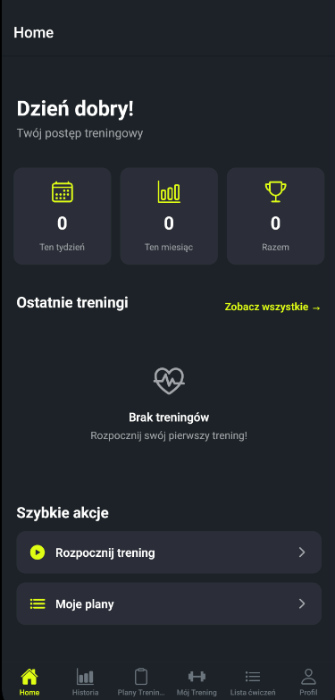
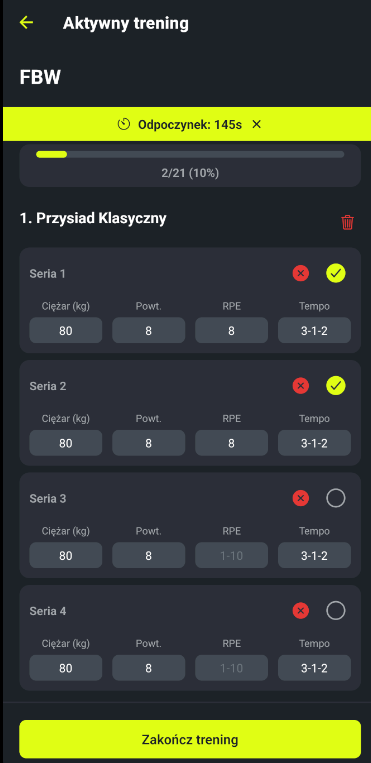
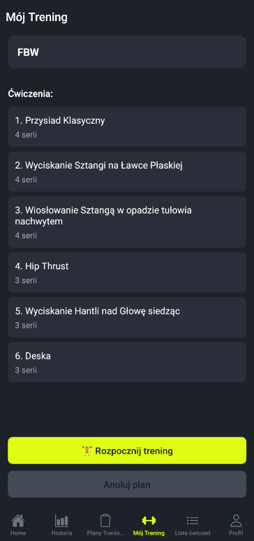
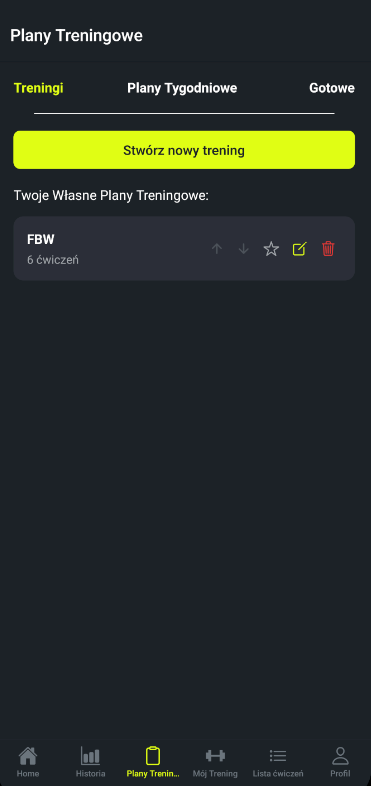
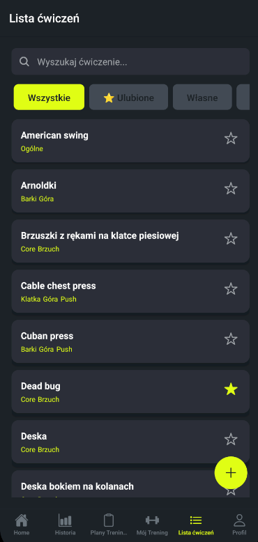

# Fortivo

Offline-first workout tracker for Android, built with React Native and Expo.

## Description

Fortivo is a strength-training app for planning workouts, running them live, and tracking progress
over time. Everything runs locally on the device — there is no account and no network dependency,
so the app works the same on the gym floor with no signal. The only outbound traffic is opt-in
crash reporting (see [Privacy](#privacy)). It targets Android; iOS is not built yet. The app's
interface is in Polish, since the target market is Poland.

Current version: 0.6.2. Closed testing on Google Play is in progress; public release will follow.

## Screenshots

| Dashboard | Live workout |
| --- | --- |
|  |  |

| Workout preview | Plans and presets |
| --- | --- |
|  |  |

| Exercise list | |
| --- | --- |
|  | |

## Tech Stack

- React Native 0.81.4
- Expo SDK 54 (`expo` ~54.0.10), Expo Router ~6.0.8
- React 19.1.0
- TypeScript ~5.9.2 (strict)
- Zustand ^5.0.8 for state
- expo-sqlite ~16.0.8 for local storage
- @react-native-async-storage/async-storage 2.2.0, for UI flags and crash-reporting consent only
- @sentry/react-native ~7.2.0 for opt-in crash reporting (EU region)
- expo-file-system ~19.0.23 and expo-sharing ~14.0.8 for the JSON data export
- react-native-reanimated ~4.1.1, react-native-keyboard-controller 1.18.5
- Jest via jest-expo ~54.0.17, with @testing-library/react-native ^13.3.3
- ESLint 9 (flat config, `no-console` as an error) + Prettier
- npm, EAS Build and EAS Submit

## Architecture

Data flows in one direction: SQLite tables, wrapped by a service layer, surfaced through custom
hooks, consumed by screens. Screens never touch the database directly.

The service layer is class-based. Each service (`WorkoutService`, `WeeklyPlanService`,
`ExerciseService`, `ProfileService`, `WeightService`, `MeasurementService`, `PresetService`,
`ExportService`) takes a database handle in its constructor and owns its SQL.

Every service transaction goes through `runInTransaction` (`database/writeLock.ts`), which chains
them so only one `BEGIN…COMMIT` is in flight at a time: expo-sqlite's `withTransactionAsync` is not
exclusive, and its unnamed `ROLLBACK` on the shared connection could cancel another caller's
transaction. The migration runner is the only direct caller. Upserts are true
`INSERT … ON CONFLICT(…) DO UPDATE`; `INSERT OR REPLACE` is banned, because with foreign keys on it
deletes the row first and fires `ON DELETE CASCADE` on its children.

Multi-step writes are orchestrated by the service, not the screen. A screen calls one method —
`workoutService.finishWorkout(...)` or `weeklyPlanService.savePlanWithDays(...)` — and each runs
as a single transaction, so a retry after a failure cannot duplicate a history entry or leave a plan
without its days.

State lives in seven Zustand stores: `workoutStore`, `weeklyPlanStore`, `exerciseStore`,
`activeWorkoutStore`, `onboardingStore`, `toastStore`, and `dbErrorStore`. `activeWorkoutStore` is
in-memory only, without `persist`: SQLite is the source of truth for a workout in progress, and
`useActiveWorkoutAutosave` writes it back on a 500 ms debounce, upserting rows by stable IDs. Two
stores double as a mailbox. When one screen needs to hand data to another across a navigation
boundary, the sender drops a value into the store and the receiver picks it up on focus —
`weeklyPlanStore.pendingWorkout` and `workoutStore.pendingExercise`. It keeps the router params
clean and avoids serializing objects through the URL.

Refresh-on-focus is its own concern. `useRefreshOnFocus` runs a loader through `useFocusEffect`
whenever a screen regains focus, so returning from an edit screen shows fresh data without a manual
pull. `useAsyncLoader` is a generic loading / error / data hook (currently used by the history
list), and `useWeeklyPlanData` composes the plan queries used across the plan screens.

Navigation is file-based through Expo Router's `app/` directory. There is no `src/` folder, and that
is deliberate: `app/` already defines the routing convention, so wrapping it in another top-level
folder added nesting without adding meaning. The rest of the code sits in sibling folders at the
repo root instead.

## Project Structure

```
app/            Screens. Expo Router file-based routing; (tabs)/ holds the tab bar.
components/     Reusable UI (Button, Card, Input, Toast, DatabaseRecoveryScreen, ...).
providers/      AppProvider — database bootstrap, services via Context, recovery gate.
services/       Class-based SQLite data layer, one service per domain, plus JSON export.
store/          Zustand stores, including the two mailbox stores and the active workout.
hooks/          Custom hooks (useRefreshOnFocus, useAsyncLoader, useActiveWorkoutAutosave, ...).
constants/      Colors, User (LOCAL_USER_ID), Links, bodyParts, preset workouts and plans.
utils/          Helpers (date, days, logger, numbers, confirm, errors, crashReporting, exportFile, ...).
types/          TypeScript types; training.ts is the main type file.
database/       database.ts — init, migrations, generateId; writeLock.ts — runInTransaction.
__tests__/      Jest tests.
__mocks__/      Jest module mocks (Sentry).
docs/           STATUS, ROADMAP, BACKLOG (known debt), DECISIONS (append-only decision log).
assets/         Icons, splash images, and README screenshots.
```

Build and app configuration live in `app.json` and `eas.json` at the root.

## Getting Started

Requires Node 20+ (the Expo SDK 54 baseline; the version is not pinned in the repo) and the Expo
tooling. Android is the only supported target.

The project uses expo-dev-client; run it on a development build. A local `expo run:android` fails on
Windows because of the 260-character path limit, so development builds come from EAS:

```bash
npm install                                              # install dependencies
eas build --profile development --platform android      # build the dev client on EAS
npm start                                                # start the Expo dev server
npm run android                                          # start Metro and open the installed dev build
```

Crash reporting reads `EXPO_PUBLIC_SENTRY_DSN` (see `.env.example`). Without it, in development, or
without the user's consent, Sentry is never initialized.

Other scripts:

```bash
npm test                # Jest
npm run test:watch      # Jest in watch mode
npm run lint            # ESLint
npm run lint:fix        # ESLint with autofix
npm run format          # Prettier write
npm run format:check    # Prettier check
npx tsc --noEmit        # type check
```

Production build and upload to Google Play:

```bash
eas build --profile production --platform android --auto-submit
```

The build is uploaded to the Play `alpha` track as a draft; publishing stays a manual step in Play
Console.

iOS support is on hold until I have access to a Mac.

## Database

Storage is SQLite through expo-sqlite, in a single `fortivo.db` file. The schema is built by 10
migration steps that run in order, gated by `PRAGMA user_version` — on launch the runner reads the
stored version and applies only the steps above it, so the current schema is version 10. Each step
runs in its own transaction and bumps `user_version` inside that same transaction, so an
interrupted upgrade resumes from the last completed step. Foreign keys are on, and the runner uses
WAL journaling.

Finishing a workout writes an immutable JSON snapshot of the performed sets
(`workout_history.performance_data`, tagged `version: 1`). History screens read the snapshot, not
the live sets, so editing a workout later never rewrites past sessions, and the next session's
prefill comes from the latest snapshot. History rows keep a denormalized workout name and survive
deleting the workout (`ON DELETE SET NULL`).

If a migration throws, the app does not crash to a blank screen: it catches the failure, closes the
connection, and renders a full-screen recovery takeover. The screen shows an error code
(`v{N} · cause`) to screenshot, tells the user their data is still on the phone, offers retry as the
primary action, and reset as a secondary one behind an irreversibility confirmation. That screen is
mounted outside the router, because at that point the service context the router depends on may
not exist.

## Privacy

- No accounts, no backend, no analytics. All training, weight and measurement data stays in SQLite
  on the device.
- Sentry crash reporting is the only outbound channel, and it is opt-in: consent is asked on an
  onboarding slide and can be changed in the profile, taking effect from the next launch. Without
  consent the Sentry client is never created. Events go to Sentry's EU region with
  `sendDefaultPii: false`, the user object removed, breadcrumbs scrubbed (no console output, no
  touch labels, no route query strings, network details trimmed to the connection type) and a cap on events per session.
- Android Auto Backup is deliberately enabled (`allowBackup: true` is explicit in `app.json`): with
  no accounts, it is the only way data survives a reinstall or a new phone.
- All data can be exported to a JSON file through the share sheet. There is no import yet, so the
  export is not a backup; import is planned for v0.7.

## Testing

Coverage is targeted rather than broad. Jest tests cover the utilities (local dates, number
parsing, logger, export file handling, crash-reporting consent), selected `ProfileService` and
`WorkoutService` methods (stale-session resolution, history details) against a mocked expo-sqlite,
the database recovery flow in `AppProvider` and `DatabaseRecoveryScreen`, and two screen-level
regression tests for deleting a workout or exercise that the active session uses. There is no CI
yet; a real in-memory SQLite harness and migration tests are on the roadmap.

## Engineering Decisions

Decisions and their reasoning are logged in [`docs/DECISIONS.md`](docs/DECISIONS.md) (in Polish).
A few of them:

- Transactions are serialized through `runInTransaction`, because concurrent transactions on one
  expo-sqlite connection could roll back each other — autosave once silently undid a workout finish.
- Upserts use `ON CONFLICT DO UPDATE` instead of `INSERT OR REPLACE`, which with cascading foreign
  keys emptied workouts of their exercises on every restart.
- Workout history is an immutable snapshot, which also gives the next session its prefill for free.
- Crash reporting skips `Sentry.init` entirely without consent instead of passing `enabled: false`,
  which still installs the native crash handlers.

## Roadmap

- Closed testing on Google Play, then the public release.
- v0.7 "Retention pack" — local reminders, weekly goal, review prompt, privacy-first product
  analytics (EU), JSON import.
- v0.8 "Logging & trust" — first free chart, logging keyboard, plate calculator, supersets UI,
  automatic local backup to a user-chosen folder.
- v0.9 "Premium content" — advanced stats, training plans with a partner coach, workout suggestions,
  import from other training logs.
- v1.0 "Pro" — monetization.
- "Wrapped" — a yearly summary card, always free.
- Cloud — account and cloud backup, then sync; behind a demand gate.
- Trainer — web panel for coaches; behind a validation gate.

## License

This repository is public for portfolio purposes. The code is not licensed
for redistribution or commercial use.
